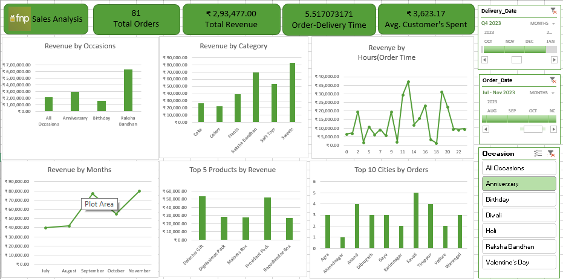

# Ferns and Petals (FNP) Sales Analysis Dashboard

## Project Overview
The FNP Sales Analysis Dashboard is a data analytics project focused on analyzing sales data from Ferns and Petals. The dashboard provides insights into total revenue, total orders, average customer spending, order delivery time, monthly sales trends, product performance, and city-wise orders.

It helps understand customer purchasing behavior, identify top-performing products, and compare revenue across different occasions.

Key Features

Total Orders and Total Revenue

Average Customer Spending

Order-to-Delivery Time Analysis

Monthly Revenue Analysis

Revenue by Occasion and Category

Top 5 Products by Revenue

Top 10 Cities by Orders

Interactive Filters for data analysis

Tools Used

Microsoft Excel

Pivot Tables

Charts and Data Visualization

Slicers and Interactive Filters

Project Objective

To analyze sales data, identify business trends, and generate insights that can support better business decisions.

## Dashboard Preview

